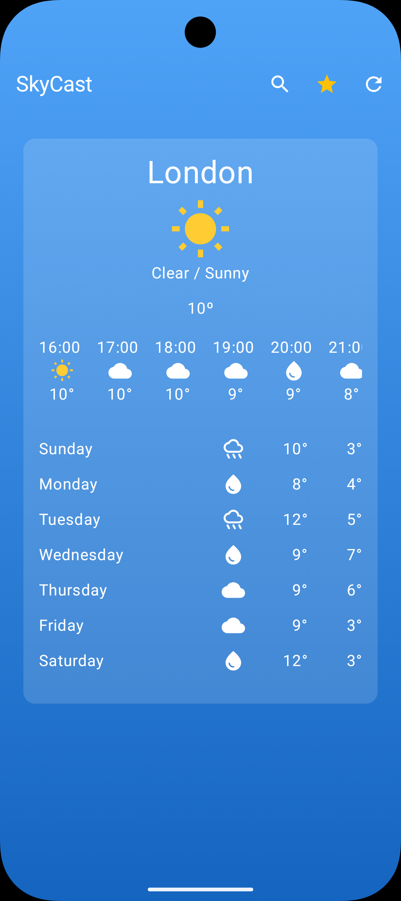
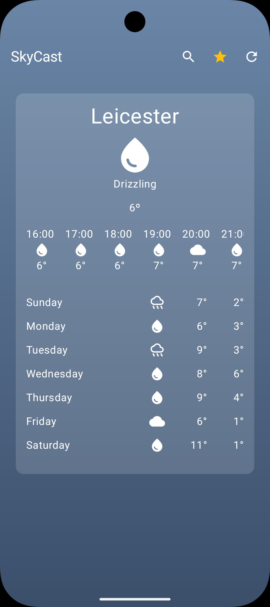
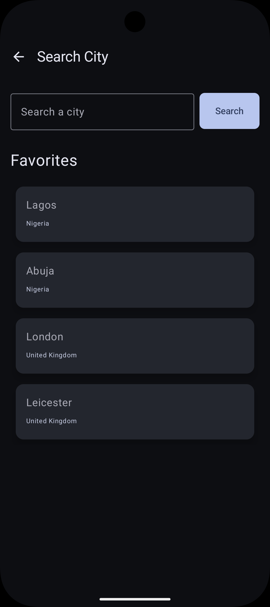
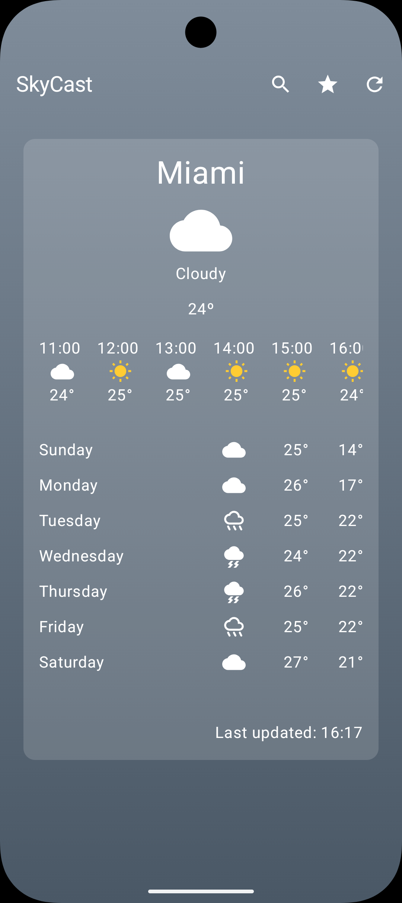
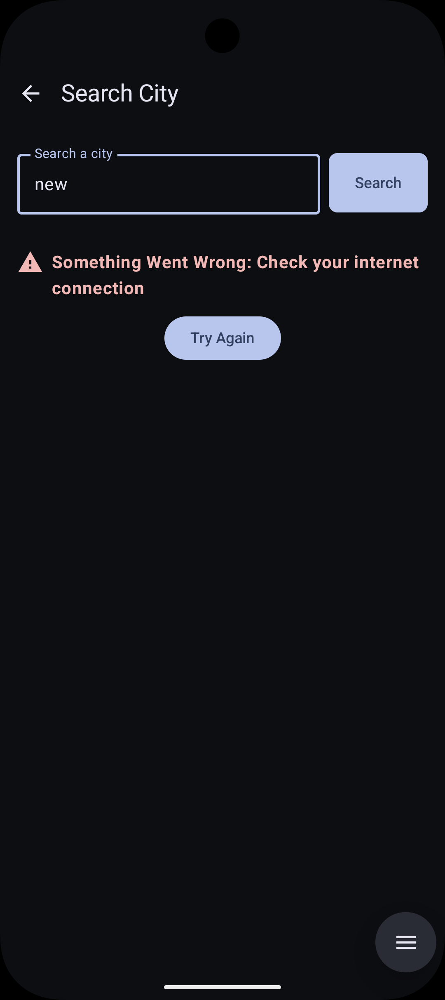
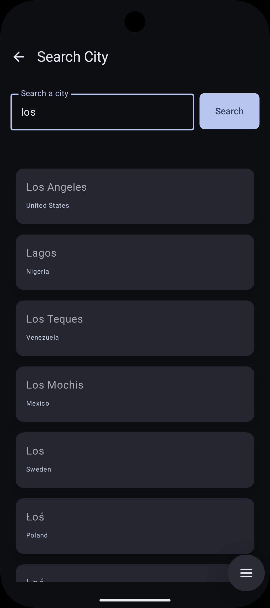
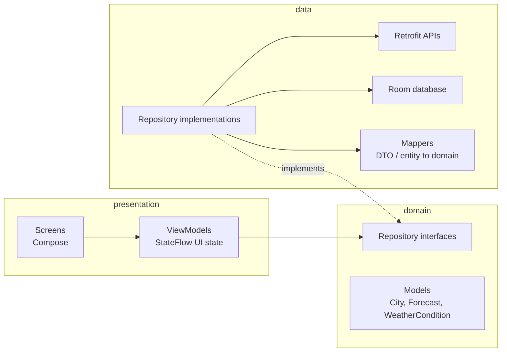

# SkyCast ☁️

A weather app for Android built with Jetpack Compose. It opens on the last city you looked at, works offline with the last saved forecast, and lets you keep a list of favorite cities.

<!-- TODO: Add your screenshots to docs/screenshots/ with these file names (or update the paths). -->
<p align="center">
  
  
  
  
  
  
</p>

## Features

- **City search**: Search any city in the world, with loading, empty and error states.
- **Current, hourly and 7-day forecast**: The hourly forecast starts from the current hour in the city's own time zone.
- **Opens where you left off**: The app starts on the weather of the last city you viewed. On first launch it opens the search screen.
- **Works offline**: Every forecast is cached. Without internet, the app shows the last saved forecast with a "Last updated" time.
- **Favorites**: Star a city on the weather screen and it shows up on the search screen.
- **Weather-based design**: Each weather condition has its own icon and background gradient.

## Tech stack

| Area | Library |
|---|---|
| UI | Jetpack Compose, Material 3 |
| Architecture | MVVM, repository pattern, unidirectional data flow with `StateFlow` |
| Dependency injection | Hilt |
| Networking | Retrofit 3, kotlinx.serialization |
| Local storage | Room |
| Asynchronous work | Kotlin Coroutines, Flow |
| Navigation | Navigation Compose with type-safe routes |
| Testing | JUnit 4, kotlinx-coroutines-test, hand-written fakes |

Minimum SDK 26, target SDK 37, Kotlin 2.2.

## Architecture

The code is split into three layers. The `domain` layer has no Android dependencies, so its models and logic can be tested on the JVM without a device.



```
com.emoulgen.skycast
├── data
│   ├── local        Room entities, DAOs, database
│   ├── mapper       DTO and entity to domain model mappers
│   ├── remote       Retrofit APIs and DTOs
│   └── repository   Repository implementations
├── di               Hilt modules
├── domain
│   ├── model        App models (no Android imports)
│   └── repository   Repository interfaces
└── presentation
    ├── navigation   Navigation graph and routes
    ├── screens      Compose screens (stateful + stateless parts)
    ├── ui           Theme and weather condition to icon / color mapping
    └── viewmodel    ViewModels and UI state
```

### Some decisions

- **Network first, cache as fallback.** Weather changes every hour, so the app always tries the network first. If the request fails with an `IOException`, it falls back to the cached forecast and marks it as `isFromCache` so the UI can show when it was last updated. The forecast is cached as the raw JSON response, which keeps the database simple and reuses the same mapper for both paths.
- **Sealed UI states.** Each screen exposes a single `StateFlow` with a sealed `Loading` / `Success` / `Error` state, so impossible combinations (for example, loading and showing an error at the same time) can't be represented.
- **Stateful and stateless composables.** Each screen has a stateful part that talks to the ViewModel and a stateless part that only renders, which makes previews possible for every state.
- **Only an id and coordinates in the route.** The weather screen loads its own data from the repository, so it always shows fresh data.

## Testing

18 unit tests cover the parts with the most logic:

- `WeatherConditionTest`: WMO weather codes to conditions
- `CityMapperTest`, `ForecastMapperTest`: DTO to domain mapping, including missing values
- `SearchViewModelTest`: idle, empty, success and network error states, using a fake repository
- `ForecastRepositoryImplTest`: online request, offline with cache, offline without cache, using a fake API and DAO

```bash
./gradlew testDebugUnitTest
```

## Building

The app uses the free [Open-Meteo](https://open-meteo.com/) API, which doesn't need an API key.

```bash
git clone https://github.com/<your-username>/SkyCast.git
```

Open the project in Android Studio and run the `app` configuration.

## Possible improvements

- Pull-to-refresh that keeps the current forecast on screen while refreshing
- Real Room migrations instead of destructive migration
- Turkish translation with `strings.xml`
- UI tests with Compose testing APIs

## Credits

Weather and geocoding data by [Open-Meteo.com](https://open-meteo.com/), licensed under [CC BY 4.0](https://creativecommons.org/licenses/by/4.0/).
